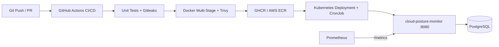

# Cloud Posture Monitor (DevOps / DevSecOps Lab)

[](https://github.com/cuauhtemocge88/cloud-posture-monitor/actions/workflows/ci.yml)
[](https://github.com/cuauhtemocge88/cloud-posture-monitor/actions/workflows/terraform-validate.yml)


API ligera en Node.js + PostgreSQL diseñada para practicar y demostrar el stack estándar de DevOps/Cloud:
**Docker -> GitHub Actions (CI + Trivy + Gitleaks) -> Kubernetes (Helm / NetworkPolicy / CronJob) -> Terraform + AWS ECS Fargate (OIDC)**.

## 🚀 Despliegue en vivo en AWS & Control FinOps

La infraestructura fue aprovisionada íntegramente mediante **Terraform** y desplegada automáticamente vía **GitHub Actions con autenticación OIDC**:
* **Arquitectura Cloud:** Amazon ECS Fargate en VPC dedicada (`10.20.0.0/16`), subnets públicas multi-AZ, registro privado Amazon ECR con análisis de vulnerabilidades on-push y logs en CloudWatch.
* **Seguridad sin credenciales estáticas:** Cero AWS access keys en GitHub Secrets; se utiliza intercambio de tokens web OIDC federado (`sts:AssumeRoleWithWebIdentity`).
* **FinOps On-Demand ($0.00/mes en reposo):** Para optimizar costos, el servicio Fargate se mantiene hibernado con `desired_count = 0`. Se enciende bajo demanda en 30 segundos con un solo clic desde GitHub Actions cuando un entrevistador o evaluador lo solicita.

### 🎮 Cómo encender/apagar el entorno en vivo (1 Clic)

1. Ve a la pestaña **[Actions > FinOps On-Demand Toggle](https://github.com/cuauhtemocge88/cloud-posture-monitor/actions/workflows/finops-toggle.yml)**.
2. Haz clic en **Run workflow**.
3. Selecciona:
   * `start`: Enciende 1 tarea Fargate, espera a que esté lista (~30 seg), detecta la IP pública asignada dinámicamente y publica el enlace en vivo en el resumen de la ejecución.
   * `stop`: Escala el servicio a 0 tareas y libera la IP pública (costo: **$0.00 USD/hr**).
   * `status`: Muestra el estado actual y el costo asociado.
4. **Auto-Apagado de Seguridad:** Incluye un cron diario que apaga automáticamente cualquier tarea activa a las 22:00 CST para garantizar cero cargos sorpresa.

## Arquitectura



## Estructura del proyecto

```text
cloud-posture-monitor/
├── app/                                  # API Node.js + Express + PostgreSQL + Prometheus
│   ├── src/
│   │   ├── app.js                        # Endpoints, cabeceras defensivas y métricas
│   │   ├── db.js                         # Pool PostgreSQL e inicialización de tablas
│   │   ├── scanner.js                    # Validación anti-SSRF y escaneo de headers HTTP
│   │   └── server.js                     # Arranque y graceful shutdown (SIGTERM/SIGINT)
│   ├── test/app.test.js                  # Pruebas unitarias con node:test
│   ├── Dockerfile                        # Multi-stage alpine, usuario no-root (node)
│   └── .dockerignore
├── k8s/                                  # Manifiestos Kubernetes (local con kind / EKS / AKS)
│   ├── namespace.yaml
│   ├── secret.example.yaml               # Plantilla (copiar a secret.yaml local o usar kubectl)
│   ├── postgres.yaml                     # PostgreSQL + readinessProbe
│   ├── api.yaml                          # 2 réplicas, probes /healthz y /readyz, readOnlyRootFilesystem
│   ├── cronjob.yaml                      # Escaneo periódico automático cada 5 min
│   └── networkpolicy.yaml                # Aislamiento Zero-Trust hacia PostgreSQL
├── infra/terraform/                      # IaC en AWS (VPC sin NAT, ECR, OIDC, ECS Fargate)
│   ├── providers.tf
│   ├── variables.tf
│   ├── main.tf
│   ├── outputs.tf
│   └── terraform.tfvars.example
├── .github/workflows/
│   ├── ci.yml                            # Tests + Gitleaks + Docker Build + Trivy + GHCR
│   └── terraform-validate.yml            # terraform fmt/validate + Trivy IaC config scan
└── docker-compose.yml                    # Stack local completo (API + PostgreSQL)
```

## Endpoints principales

* `GET /healthz`: Liveness probe para Kubernetes.
* `GET /readyz`: Readiness probe (verifica conectividad real contra PostgreSQL).
* `GET /metrics`: Métricas en formato Prometheus (`http_requests_total`, `posture_scans_total`).
* `POST /api/targets` & `GET /api/targets`: Registro y listado de URLs a monitorear (bloquea hosts privados por defecto).
* `POST /api/scan`: Evalúa disponibilidad, latencia y cabeceras defensivas (`HSTS`, `CSP`, `X-Content-Type-Options`, `X-Frame-Options`).
* `GET /api/posture`: Resumen consolidado del último escaneo por objetivo.

## Ejecución local

### Opción A: Solo Node.js (modo en memoria)
```bash
cd app
npm install
npm test
npm start
```

### Opción B: Contenedor completo (API + PostgreSQL)
```bash
docker compose up --build
```

Probar endpoints:
```bash
curl http://localhost:8080/healthz
curl http://localhost:8080/readyz
curl -X POST http://localhost:8080/api/targets -H "Content-Type: application/json" -d '{"name":"Example","url":"https://example.com"}'
curl -X POST http://localhost:8080/api/scan
curl http://localhost:8080/api/posture
```

## Despliegue en Kubernetes (con Helm)

```bash
# Validar la sintaxis del chart
helm lint charts/cloud-posture-monitor

# Instalar el release en Kubernetes
helm upgrade --install posture-release ./charts/cloud-posture-monitor \
  --create-namespace \
  --namespace posture-monitor \
  --set postgres.password="tu_password_seguro"

# Verificar los pods y servicios
kubectl -n posture-monitor get all
```

## Despliegue alternativo con manifiestos directos (`kubectl`)

```bash
kind create cluster --name posture-lab
docker build -t cloud-posture-monitor:local ./app
kind load docker-image cloud-posture-monitor:local --name posture-lab

kubectl apply -f k8s/namespace.yaml
kubectl apply -f k8s/secret.example.yaml
kubectl apply -f k8s/postgres.yaml
kubectl apply -f k8s/api.yaml
kubectl apply -f k8s/cronjob.yaml
kubectl apply -f k8s/networkpolicy.yaml

kubectl -n posture-monitor port-forward svc/posture-api 8080:8080
```

## Validación de Terraform (sin gastar en AWS aún)

```bash
cd infra/terraform
terraform fmt -check
terraform init -backend=false
terraform validate
```
